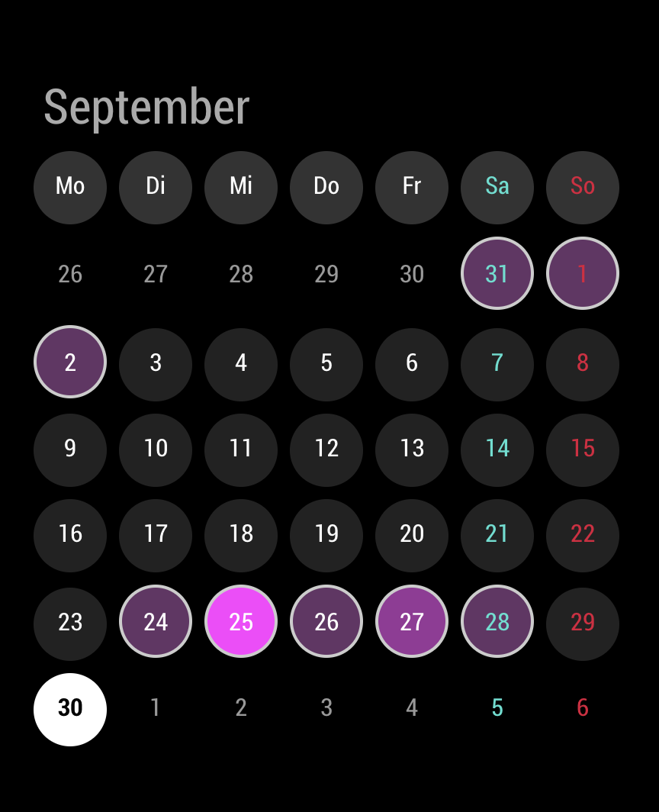

# MMM-CalendarExtMiniMonth

Mini month plugin for the default `calendar` module and [MMM-CalendarExt2](https://github.com/MagicMirrorModules/MMM-CalendarExt2).

## Screenshot



## Installation

This module works with the default `calendar` module or [MMM-CalendarExt2](https://github.com/MagicMirrorModules/MMM-CalendarExt2).

```sh
cd ~/MagicMirror/modules
git clone https://github.com/MagicMirrorModules/MMM-CalendarExtMiniMonth
```

## Update

```sh
cd ~/MagicMirror/modules/MMM-CalendarExtMiniMonth
git pull
```

## Configuration

Basic example:

```js
{
  module:"MMM-CalendarExtMiniMonth",
  position:"top_left",
},
```

### Configuration options

All options are optional. Add overrides to the module's `config` object in your MagicMirror configuration.

| Option              | Default            | Description                                                                                                |
| ------------------- | ------------------ | ---------------------------------------------------------------------------------------------------------- |
| `locale`            | `null`             | Uses the MagicMirror locale.                                                                               |
| `dynamicEventColor` | `["#333", "#F3F"]` | CSS colors for the event-count gradient. Set to `null` to disable the fill and show only the event border. |
| `refreshInterval`   | `600000`           | Refresh interval in milliseconds.                                                                          |
| `titleFormat`       | `"MMMM"`           | Format pattern for the month header, such as `"MMMM"` or `"MMM"`.                                          |
| `weekdayFormat`     | `"dd"`             | Weekday label format: `"dd"`, `"ddd"`, or `"dddd"`.                                                        |
| `dateFormat`        | `"D"`              | Day number format: `"D"`, `"Do"`, or `"DD"`.                                                               |
| `calendars`         | `[]`               | Calendar names to include. An empty array includes all calendars.                                          |
| `source`            | `"CALENDAR"`       | Event source: `"CALENDAR"` or `"CALEXT2"`.                                                                 |

### Configuration example

Add an entry like this to the `modules` array in your `config.js`:

```js
{
  module: "MMM-CalendarExtMiniMonth",
  position: "top_left",
  config: {
    calendars: ["Family Calendar"],
    dynamicEventColor: ["#000099", "#000099"],
    source: "CALEXT2"
  }
},
```

When using the default `calendar` module, make sure its config enables `broadcastEvents: true`.

## Styling

See MMM-CalendarExtMiniMonth.css
